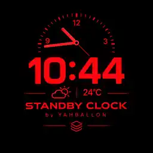
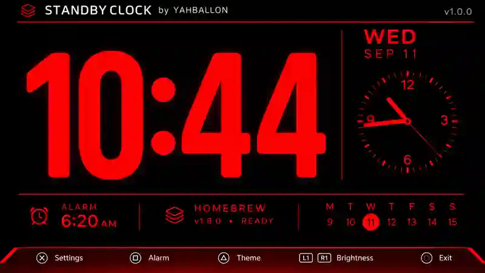

<div align="center">



# STANDBY CLOCK

### An elegant, always-on clock for PS5 homebrew

**by YAHBALLON · v0.1.2 · PPSA99876**

[](https://github.com/Yahballon/PS5_StandbyClock/actions/workflows/build.yml)
[](https://github.com/Yahballon/PS5_StandbyClock/releases/latest)

</div>

---

## Preview

<div align="center">
  <a href="screenshots/standby-clock-ui.webp">
    
  </a>
  <p><sub>Design showcase supplied by the project owner, not an on-console capture. Current v0.1.2 has live weather in place of the HOMEBREW/READY tile. Appearance may differ.</sub></p>
</div>

## Features

| | Feature | Description |
|---|---|---|
| 🕙 | **Digital clock** | Oversized clock, 12/24-hour mode and live system time |
| 🕰️ | **Analog clock** | Moving second hand and dial tick marks |
| 📅 | **Week calendar** | Date plus a Monday-first seven-day week strip |
| ⏰ | **Alarm** | In-app alarm, dismiss and five-minute snooze |
| ☁️ | **Live weather** | Approximate IP-based city, real temperature and condition |
| 🎨 | **Themes** | Red, amber, ice blue and white on pure black |
| 🌙 | **OLED guard** | Full-display pixel shift, idle/night dim and periodic brief dark breaks |
| 💾 | **Persistence** | Settings, alarm and weather cache saved between sessions |
| 🛠️ | **Native PS5** | Native OpenGL homebrew, no WebKit page |

## Download / installation

**[Download latest release](https://github.com/Yahballon/PS5_StandbyClock/releases/latest)**

1. Download **PPSA99876.zip** from the release assets.
2. Extract the **PPSA99876** directory.
3. Install or replace this directory using your working jailbroken PS5 homebrew installation method (e.g. ShadowMountPlus).
4. Launch **Standby Clock**.

**Title ID:** PPSA99876. Updates use the same ID.

> A successful native build and valid ZIP are checked by GitHub Actions. Launch and networking behavior must still be confirmed on actual compatible PS5 hardware.

## DualSense controls

| Button | Clock view | Settings |
|---|---|---|
| **✕ Cross** | Settings / dismiss active alarm | Change selected option |
| **□ Square** | Open alarm settings | — |
| **△ Triangle** | Change theme | — |
| **L1 / R1** | Lower / raise brightness | — |
| **Options** | Settings | Save and return |
| **D-Pad / Left stick** | — | Navigate and adjust |
| **◯ Circle** | Exit / snooze alarm for 5 minutes | Save and return |

## Automatic weather

The old **HOMEBREW / READY** tile becomes a real weather panel. The application looks up an approximate city using the console's public IP via [ipapi.co](https://ipapi.co/), then obtains current measurements from [Open-Meteo](https://open-meteo.com/).

Network requests run on a background worker and normally refresh every **15 minutes**. The last successful reading is cached for up to 24 hours. An expired or missing reading shows an offline indicator, never a fabricated temperature. Switch off automatic requests with **Settings → AUTO WEATHER**.

**Privacy:** Weather queries reveal the PS5 network's public IP to the third-party location and weather services. IP-area detection is approximate; VPNs/ISPs can return the wrong city.

## OLED protection

The optional guard is enabled by default: move the **whole screen** among eight positions every 90 seconds, dim after 2/10 minutes of inactivity, dim a little further from 23:00–07:00, and briefly black out the display for 20 seconds every 30 minutes of idle use. Settings and active alarm screens suppress these protections.

OLED protection helps reduce the risk of static-image retention, but **does not prevent burn-in completely** or replace your television's built-in maintenance. Toggle **OLED PROTECTION**, **AUTO DIM / NIGHT** and **OLED PIXEL SHIFT** in Settings.

## Developer notes

Source layout:

- **native/main.cpp** — native PS5 UI, renderer, controller and alarm
- **native/clock_logic.hpp** — clock, calendar and saved preferences
- **native/weather_client.cpp** — async validated-TLS weather worker and cache
- **native/weather_model.hpp** — bounded weather and geolocation response parsing
- **tests/** — portable clock and weather parser checks
- **assets/logo.webp** — new AI-generated red-black icon design without outer border
- **assets/create_icon.py** — 512 × 512 installer icon generator
- **screenshots/standby-clock-ui.webp** — user-provided UI design preview
- **.github/workflows/build.yml** — native compile, package verification, immutable GitHub Release

Portable tests:

```bash
g++ -std=c++20 -O2 -Wall -Wextra tests/clock_test.cpp -o /tmp/clock-test && /tmp/clock-test
g++ -std=c++20 -O2 -Wall -Wextra tests/weather_test.cpp -o /tmp/weather-test && /tmp/weather-test
```

The workflow fetches [PS5-DevBridge](https://github.com/Yahballon/PS5-DevBridge) simple-calc scaffold and [ps5-homebrew-ui](https://github.com/blackbearreloaded/ps5-homebrew-ui), prepares the SDK, and builds a native **PPSA99876.zip** with the supplied logo as **sce_sys/icon0.png**.

Runtime files are in **/data/StandbyClock/**: **settings.ini**, **clock.log**, **weather.txt**, and **weather-location.txt**.

**Limitations:** The alarm only works while the app is open. It cannot wake the PS5 from suspend and does not have alarm audio. OLED and network behavior require console testing.

## Credits / license

**Standby Clock by YAHBALLON**. Repository licensing is described in [LICENSE](LICENSE). The renderer and SDK maintain their own upstream licenses. No Sony proprietary assets or PlayStation logos are included.
